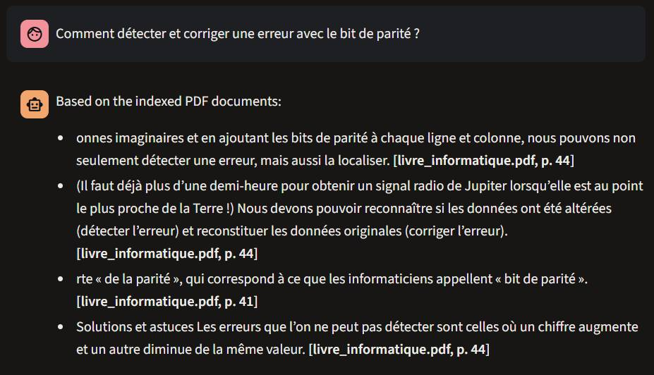
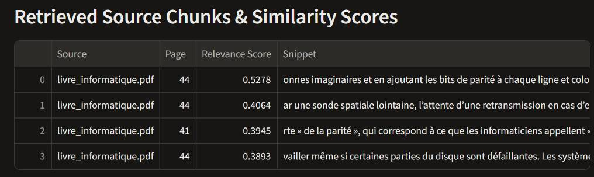
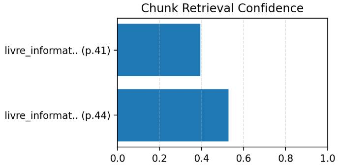

<div align="center">

#  Multi-PDF RAG Assistant with Exact Page Citations

### Local hybrid semantic + lexical retrieval with verifiable `[Document.pdf, p. X]` grounding

<p>
  
  
  
  
  
 
</p>

**A local-first Retrieval-Augmented Generation (RAG) chatbot that ingests multi-page PDFs, runs hybrid semantic + lexical search, and answers with inline, verifiable page citations.**

</div>


##  Tech Stack

| Layer | Technology | Role |
|:--|:--|:--|
|  **PDF Parsing** | `pypdf` | Page-by-page text extraction with source filename + page metadata |
|  **Semantic Retrieval** | `sentence-transformers` · `all-MiniLM-L6-v2` | Dense embeddings for conceptual / paraphrase matching |
|  **Lexical Retrieval** | `scikit-learn` · TF-IDF | Exact keyword and technical-term matching |
|  **Ranking** | Cosine similarity (hybrid score) | Top-K chunk selection |
|  **Interface** | `Streamlit` | Chat UI, evidence inspector, confidence charts |

---


##  Architecture

```mermaid
flowchart LR
    A[" <b>Multi-PDF Loader</b><br/>pypdf page parser"]:::blue
    B[" <b>Overlapping Chunker</b><br/>size + overlap + metadata"]:::green
    C[" <b>Hybrid Index</b><br/>65% SBERT + 35% TF-IDF"]:::orange
    D[" <b>Top-K Ranking</b><br/>cosine similarity"]:::purple
    E[" <b>Grounded Synthesis</b><br/>hallucination guard + citations"]:::red
    F[" <b>Evidence Inspector</b><br/>chunks + confidence charts"]:::yellow

    A --> B --> C --> D --> E --> F

    classDef blue fill:#1E88E5,stroke:#0D47A1,color:#fff,stroke-width:2px;
    classDef green fill:#43A047,stroke:#1B5E20,color:#fff,stroke-width:2px;
    classDef orange fill:#FB8C00,stroke:#E65100,color:#fff,stroke-width:2px;
    classDef purple fill:#8E24AA,stroke:#4A148C,color:#fff,stroke-width:2px;
    classDef red fill:#E53935,stroke:#B71C1C,color:#fff,stroke-width:2px;
    classDef yellow fill:#FDD835,stroke:#F9A825,color:#000,stroke-width:2px;
```




##  Retrieval Details

```text
final_score = 0.65 × cosine(SBERT query, SBERT chunk)
            + 0.35 × cosine(TF-IDF query, TF-IDF chunk)

if max(final_score) < 0.12  →  abstain ("not found in the documents")
else                        →  answer + [Source.pdf, p. X] citations
```

| Parameter | Value |
|:--|:--|
| Embedding model | `all-MiniLM-L6-v2` |
| Semantic weight | `0.65` |
| Lexical weight | `0.35` |
| Abstention threshold (`min_score`) | `0.12` |
| Citation format | `[Document.pdf, p. X]` |

---

##  Visual Preview

### 1. Grounded chat response with inline page citations


### 2. Retrieved source chunks & cosine similarity scores


### 3. Chunk retrieval confidence distribution


---

##  Quickstart

```bash
# 1. Clone the repository
git clone https://github.com/<your-username>/pdf-rag-assistant.git
cd pdf-rag-assistant

# 2. Install dependencies
pip install -r requirements.txt

# 3. Launch the app
python -m streamlit run app.py
```